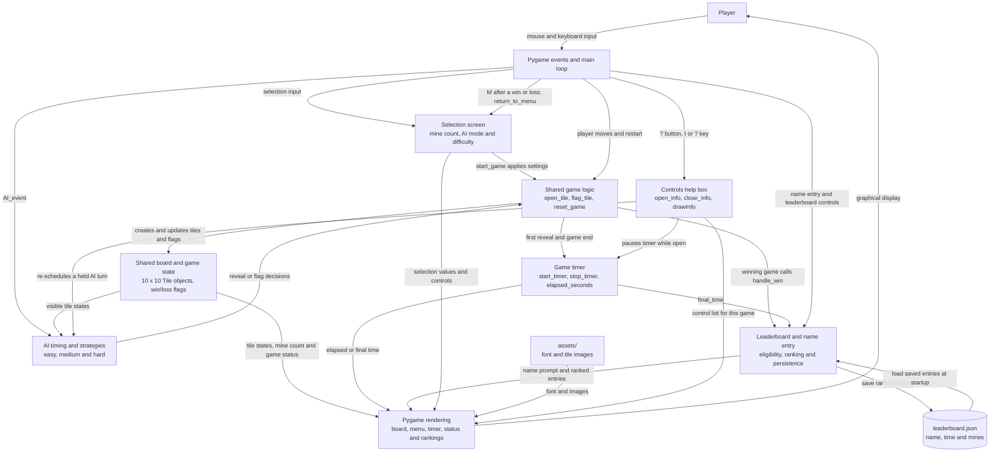
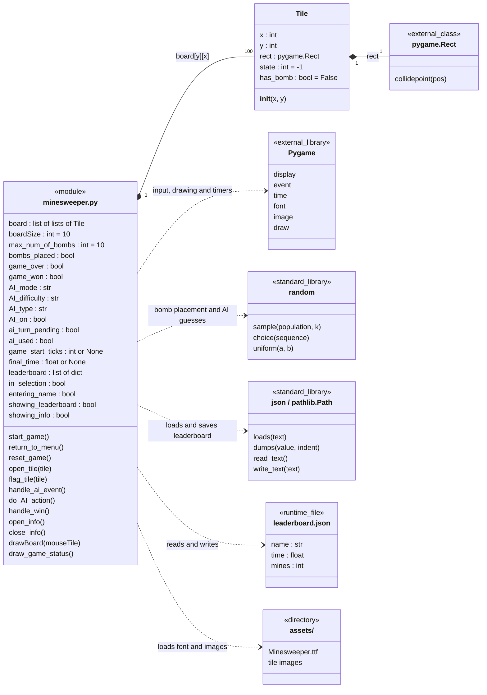
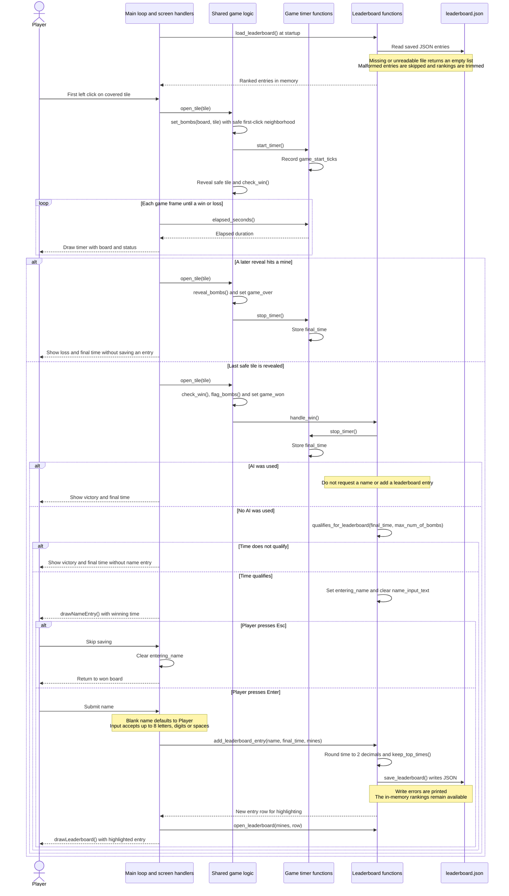
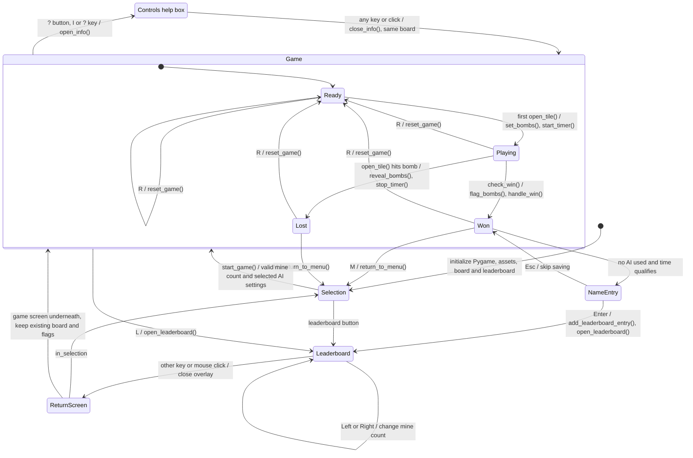
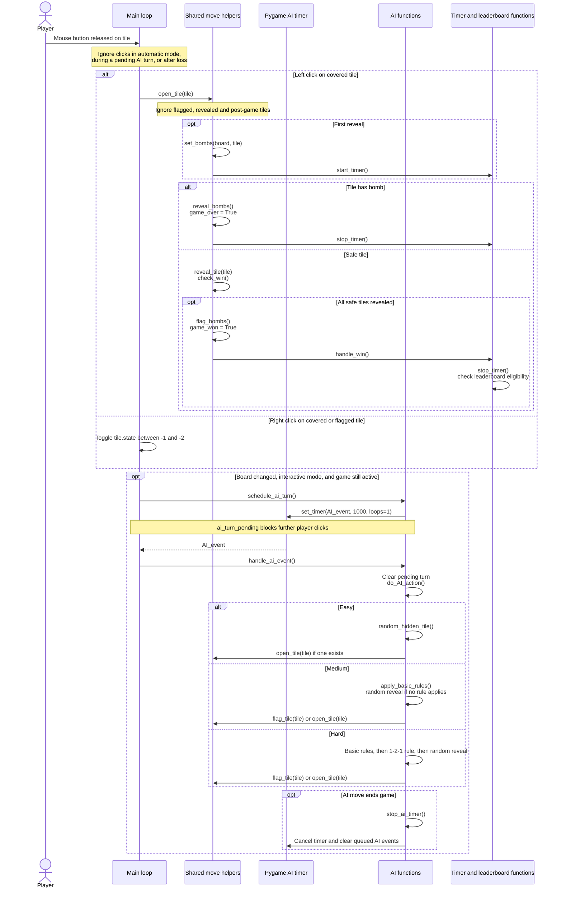

<!--
# Course: EECS 581: Software Engineering II
# Project: Minesweeper (Project 2 - Enhance Another Team's Minesweeper System)
# Description: Project overview, setup and controls, AI solver rules, custom
#              timer/leaderboard feature, system architecture and UML diagrams.
# Inputs:
#     The current minesweeper.py source and documentation/NewUML.md diagrams.
# Outputs:
#     Repository README rendered by GitHub, including Mermaid UML diagrams.
# Author: Kyler Russell
# Source attribution: Created with the assistance of Claude (Opus 5.5). The
#                     diagrams are adapted from documentation/NewUML.md by
#                     Carter Steenhard.
# Date: 10/11/2026
-->

# Minesweeper with an AI Solver

A Python/Pygame Minesweeper game for **EECS 581 Software Engineering II (Fall 2026), Project 2**.
Our team (Group 1) inherited Group 2's Project 1 Minesweeper and extended it on top of the original code. We:

- fixed the Project 1 requirements that were missing or buggy,
- added an **AI solver** with Easy, Medium and Hard difficulties that can take turns with you or play on its own, and
- added a **custom feature**: a game timer with a local leaderboard of the fastest wins for each mine count.

All game code is in one module, [`EECS-581-Project-1-Group-2/minesweeper.py`](EECS-581-Project-1-Group-2/minesweeper.py).

---

## Contents

- [Running the game](#running-the-game)
- [How to play](#how-to-play)
- [AI solver](#ai-solver)
- [Custom addition: timer and leaderboard](#custom-addition-timer-and-leaderboard)
- [System architecture](#system-architecture)
- [UML diagrams](#uml-diagrams)
- [Key data structures](#key-data-structures)
- [Extending the system](#extending-the-system)
- [Repository layout](#repository-layout)
- [Authors and attribution](#authors-and-attribution)

---

## Running the game

**Requirements:** Python 3 (developed with Python 3.12) and **pygame 2.0.1 or newer**.

```bash
pip install pygame
python EECS-581-Project-1-Group-2/minesweeper.py
```

The game finds its font and images relative to `minesweeper.py`, so you can run it from any folder. The window can be resized and the game scales with it.

---

## How to play

### 1. Set up a game

The game opens on a setup menu:

| Setting | Options |
| --- | --- |
| Number of mines | 10 to 20. Type a number, or use the Up and Down arrows. **Start Game** stays disabled until the number is valid. |
| AI type | **Manual**: no AI. **Interactive**: you and the AI take turns. **Automatic**: the AI plays by itself. |
| AI difficulty | **Easy**, **Medium** or **Hard**. Shown only when an AI type is chosen. |

Press **Start Game** (or Enter) to begin. The **Leaderboard** button shows saved best times.

### 2. Play

The board is a 10 × 10 grid with columns labeled **A–J** and rows labeled **1–10**. Your first click is always safe, and so are the 8 tiles around it, so every game starts with an opening.

| Input | Action |
| --- | --- |
| Left click | Open a tile. A number shows how many mines touch it, and a blank tile opens its neighbors automatically. |
| Right click | Place or remove a flag |
| **R** | Restart with the same settings |
| **M** | Return to the setup menu (after a win or loss) |
| **L** | Open the leaderboard |
| **E** | Turn AI play on or off (uses the chosen difficulty, or Easy) |
| **?** button, **I** or **?** | Open the controls help box (pauses the timer) |

Below the board the game shows the elapsed time, whose turn it is (in AI games), **Mines remaining** (mines minus flags placed) and a status line: *Playing*, *Victory*, *Game Over: Loss*, or the AI mode during AI games.

### 3. End of the game

- **Loss:** opening a mine ends the game and reveals every mine.
- **Win:** opening every tile without a mine wins, and all mines are flagged automatically.

After either one, press **R** to play again with the same settings or **M** to go back to the menu.

---

## AI solver

The AI plays on the same board as the player, and all of its moves go through the same `open_tile()` / `flag_tile()` helpers. Mine placement, flood fill, the timer, and win/loss checks therefore work the same no matter who moves.

**Modes**

- **Interactive:** each player move (a reveal or a flag change) is answered by one AI move a second later. Clicks are ignored while the AI is taking its turn.
- **Automatic:** the AI makes one move per second until the game is won or lost. Player clicks are ignored.

**Difficulties**

| Level | Strategy |
| --- | --- |
| Easy | Opens a random tile that is not open and not flagged. |
| Medium | Goes through the revealed numbers and applies the first rule that works: **(1)** if the number of covered neighbors (hidden plus flagged) equals the number, flag all the hidden ones; **(2)** if the number of flagged neighbors equals the number, open the remaining hidden ones. If no rule applies, it opens a random hidden tile. |
| Hard | Medium's rules, then the **1-2-1 pattern**: three side-by-side revealed tiles reading 1-2-1, with every covered neighbor in the single line of tiles on one side, mean the two outer tiles of that line are mines (flagged) and the middle one is safe (opened). If nothing applies, it opens a random tile. |

The AI trusts the flags on the board, so in interactive mode a wrong flag placed by the player can lead Medium or Hard into a mine. In headless tests over thousands of automatic games, the AI never placed a wrong flag on its own, and every AI loss came from a random guess, not from a rule.

---

## Custom addition: timer and leaderboard

- **Timer:** starts on the first reveal and stops on a win or loss, after which the exact final time stays on screen.
- **Leaderboard:** keeps the 10 fastest wins **for each mine count** (10–20), so a win is compared only with games that had the same number of mines. Only games won **without AI help** count; games started in an AI mode or helped with **E** are excluded.
- **Name entry:** a qualifying win asks for a name of up to 8 letters, digits or spaces. Esc skips saving.
- **Storage:** scores are saved to `leaderboard.json` next to `minesweeper.py`. The file is created when first needed and is ignored by git. A missing or damaged file starts an empty leaderboard instead of crashing.

The full UML sequence diagram for this feature is [below](#custom-addition-sequence-diagram).

---

## System architecture

`minesweeper.py` is one Pygame program built around a main loop. Each frame, the loop sends input to whichever screen is active and redraws that screen at up to 60 FPS. The screens are the **setup menu**, the **game board**, and three overlays: **name entry**, **leaderboard** and **controls help**. The logical components are:

| Component | Responsibility | Main functions |
| --- | --- | --- |
| Main loop and events | Sends mouse, keyboard, timer and quit events to the active screen | `while True` loop at the bottom of the file |
| Setup menu | Mine count, AI mode and difficulty; starts a game | `drawSelection`, `handle_selection_event`, `start_game`, `return_to_menu` |
| Shared game logic | The single path for every reveal and flag, used by the player and the AI | `open_tile`, `flag_tile`, `reveal_tile`, `set_bombs`, `check_win`, `reset_game` |
| Board state | 10 × 10 grid of `Tile` objects plus win/loss flags | `board`, `Tile`, `game_over`, `game_won` |
| AI timing and strategies | Schedules AI moves with Pygame timer events and picks moves | `start_ai_timer`, `schedule_ai_turn`, `handle_ai_event`, `easy/medium/hard_AI_action`, `apply_basic_rules`, `apply_121_rule` |
| Game timer | Measures game duration | `start_timer`, `stop_timer`, `elapsed_seconds` |
| Leaderboard | Eligibility, ranking, name entry and the JSON file | `handle_win`, `add_leaderboard_entry`, `load_leaderboard`, `save_leaderboard`, `drawLeaderboard` |
| Controls help | Lists the controls; pauses the timer and holds AI turns while open | `open_info`, `close_info`, `drawInfo` |
| Rendering | Draws the board, labels, footer text and overlays | `drawBoard`, `draw_game_status`, `draw_button`, `draw_text_centered` |

**Data flow:** player input or an `AI_event` leads to `open_tile()` / `flag_tile()`. These update the `Tile` states in `board`, start or stop the timer, and on a manual win call `handle_win()`, which may write `leaderboard.json`. The next frame then draws the new state.

---

## UML diagrams

These Mermaid diagrams render directly on GitHub. [`documentation/NewUML.md`](documentation/NewUML.md) has the same diagrams with more notes.

### System architecture overview



### Module and tile structure (class diagram)

`Tile` is the only class. The game state and functions are module-level members of `minesweeper.py`.



### Custom addition sequence diagram

The timer and leaderboard flow, from startup through a loss, an AI-assisted win, a time that doesn't qualify, and a saved score.



### Game and screen states



### Interactive AI turn



---

## Key data structures

**`board`** is a list of 10 rows, each holding 10 `Tile` objects, and is indexed **`board[y][x]`** (row first).

**`Tile`** has `x`, `y`, `rect` (its `pygame.Rect` on screen), `has_bomb`, and `state`:

| `state` | Meaning |
| --- | --- |
| `-1` | Covered |
| `-2` | Flagged |
| `-3` | Revealed mine (game lost) |
| `0` | Revealed blank |
| `1`–`8` | Revealed number of neighboring mines |

**Leaderboard entry** (one item in the list saved to `leaderboard.json`):

```json
{ "name": "ExampleName", "time": 42.17, "mines": 12 }
```

**Main game flags:** `in_selection`, `game_over`, `game_won`, `bombs_placed`, `AI_mode` (`manual` / `interactive` / `automatic`), `AI_type` (`easy` / `medium` / `hard`), `AI_on`, `ai_turn_pending`, `ai_used`, `game_start_ticks`, `final_time`, `showing_leaderboard`, `entering_name`, `showing_info`.

---

## Extending the system

The timer and leaderboard are the feature our team added, so this section explains how they work inside `minesweeper.py` and how to change them safely. The code is in the *"Local leaderboard"* section of the file, with the timer functions near `reset_game()`.

### How the leaderboard works

1. **Startup:** `leaderboard = load_leaderboard()` reads `leaderboard.json` into memory as a list of `{name, time, mines}` dictionaries. A missing or unreadable file gives an empty list, and malformed entries are skipped one at a time, so a bad file never stops the game.
2. **Timing:** the first reveal of a game (in `open_tile()`) calls `start_timer()`, which records `game_start_ticks`. A loss or win calls `stop_timer()`, which stores `final_time`. `elapsed_seconds()` is what the footer displays. The controls help box pauses the timer by moving `game_start_ticks` forward when it closes.
3. **Win check:** `open_tile()` calls `handle_win()`. It asks for a name only if the game had no AI help (`ai_used` is `False`) and `qualifies_for_leaderboard(final_time, mines)` is true. That means the list for this mine count has fewer than `LEADERBOARD_SIZE` entries, or the time is **strictly faster** than the current last place.
4. **Name entry:** `entering_name` switches the main loop to `drawNameEntry()` / `handle_name_entry_event()`. Enter saves (a blank name becomes "Player") and Esc skips.
5. **Saving:** `add_leaderboard_entry()` rounds the time to 2 decimals, appends it, calls `keep_top_times()` to sort and trim each mine count's list, writes the file with `save_leaderboard()`, and returns the new entry's row so it can be highlighted.
6. **Viewing:** `open_leaderboard(mines, highlight)` sets `showing_leaderboard`, and the main loop then draws `drawLeaderboard()` over the current screen. Left and Right change `leaderboard_mines`; any other key or click closes it. It opens from the menu button, the **L** key, and after a saved win.

| Function / value | Role |
| --- | --- |
| `LEADERBOARD_FILE` | Where scores are stored (`leaderboard.json` next to `minesweeper.py`) |
| `LEADERBOARD_SIZE` (10) | How many times are kept for each mine count |
| `NAME_MAX_LENGTH` (8) | Longest name allowed on the name entry screen |
| `keep_top_times(entries)` | Stable sort by time (earlier ties stay ahead) and trim to `LEADERBOARD_SIZE` for each mine count |
| `times_for_mines(mines)` | One mine count's ranked list, fastest first |
| `qualifies_for_leaderboard(seconds, mines)` | Whether a time would make that mine count's list |
| `load_leaderboard()` / `save_leaderboard()` | The only two functions that touch the file |
| `handle_win()` | Stops the timer and decides whether to ask for a name |
| `ai_used` | Set by `reset_game()` for AI modes and by the **E** key; blocks leaderboard entry |

### Common changes

**Keep more or fewer times.** Change `LEADERBOARD_SIZE`. The screen fits **13 rows** (rows are 13 px apart starting at `header_y + 14`), so going past 13 needs a smaller row spacing, a taller window, or scrolling in `drawLeaderboard()`.

**Allow longer names.** Change `NAME_MAX_LENGTH`. Names start at `name_x = 30` and times are right-aligned at `windowWidth - 14`, so there is room for about 12 wide characters before a name runs into the time column.

**Add a field to each entry** (for example the date of the win). Make the change in three places, and give old entries a default so existing `leaderboard.json` files still load:

```python
import datetime   # at the top of the file

# add_leaderboard_entry(): store the new field
entry = {'name': name, 'time': round(seconds, 2), 'mines': mines,
         'date': datetime.date.today().isoformat()}

# load_leaderboard(): read it with a default for entries saved before the change
'date': str(entry.get('date', '')),

# drawLeaderboard(): add a column, e.g. with draw_text_aligned(entry['date'], ...)
```

**Rank by something other than mine count** (for example board size or difficulty, if those are added). Entries are grouped by `entry['mines']` in three places: `keep_top_times()`, `times_for_mines()` and `qualifies_for_leaderboard()`. The screen pages through mine counts using `leaderboard_mines`, `MIN_MINES` and `MAX_MINES`. Replace those with a shared key, such as a `leaderboard_key(entry)` helper returning `(mines, board_size)`, and update the Left/Right paging in `handle_leaderboard_event()` to step through the keys.

**Track AI scores separately.** AI-assisted wins are currently thrown away by the `not ai_used` check in `handle_win()`. To keep them, store an `ai` field (`AI_type` or `None`) with each entry, include it in the grouping key above, and remove the check.

**Use a different storage location or an online leaderboard.** Only `load_leaderboard()` and `save_leaderboard()` read or write the file, and the rest of the game uses the in-memory `leaderboard` list. Replace those two functions (for example, with calls to a web service) and keep two rules: return the same list of `{name, time, mines}` dictionaries, and catch every error and fall back to an empty or unchanged list so a network or disk problem never crashes the game. Keep any slow request out of the 60 FPS main loop (load once at startup, save only after a win).

**Testing changes.** Delete `leaderboard.json` to start from an empty leaderboard. To check that bad data is handled, put malformed JSON or entries with missing fields in the file and make sure the game still starts. Remember that a win only counts in **Manual** mode without pressing **E**.

### Other extension points

- **New AI strategy:** write a function that uses `open_tile()` / `flag_tile()` and returns `True` when it made a move. Call it from an `*_AI_action()` function, or add a new difficulty to `do_AI_action()`, `AI_DIFFICULTIES` and `AI_DIFFICULTY_LABELS`.
- **New overlay screen:** follow the leaderboard and help box pattern: a `showing_*` flag, a draw function, an event handler, and a branch in the main loop. If the overlay can open mid-game, re-schedule a pending interactive AI turn when it closes, as `close_info()` does.

---

## Repository layout

```
EECS-581-Project-1-Group-2/
    minesweeper.py           the game
    assets/                  pixel font and tile images
    README.md                original Project 1 README
documentation/
    NewUML.md                architecture overview and UML diagrams
    estimated-hours.txt      person-hours estimate and method
    actual-hours/            day-by-day hours for each team member
    meeting-notes/           weekly meeting notes
    project1/                documentation inherited from Group 2
README.md                    this file
```

---

## Authors and attribution

**Project 2 (Group 1):** Drew Medlock, Kyler Russell, Luke Reicherter, Alex Rawson, Blake Pennel, Carter Steenhard, Kyle Fleming

**Original Project 1 (Group 2):** Parker Albright, Aidan Atwood, Joseph Wen H Tan, Ever Armenta, Atique Ahanaf Danial, Viren Chowdary Padarthi ([original repository](https://github.com/VirenPadarthi/EECS-581-Project-1-Group-2))

Parts of the code and documentation were written with the help of generative AI (Claude Opus 5.5 and OpenAI Codex). Each such section is marked in the source's file header and in-code comments with its author and the tool used.
