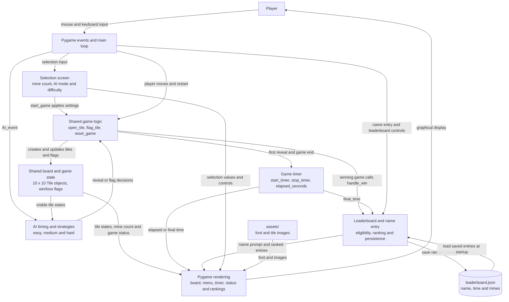
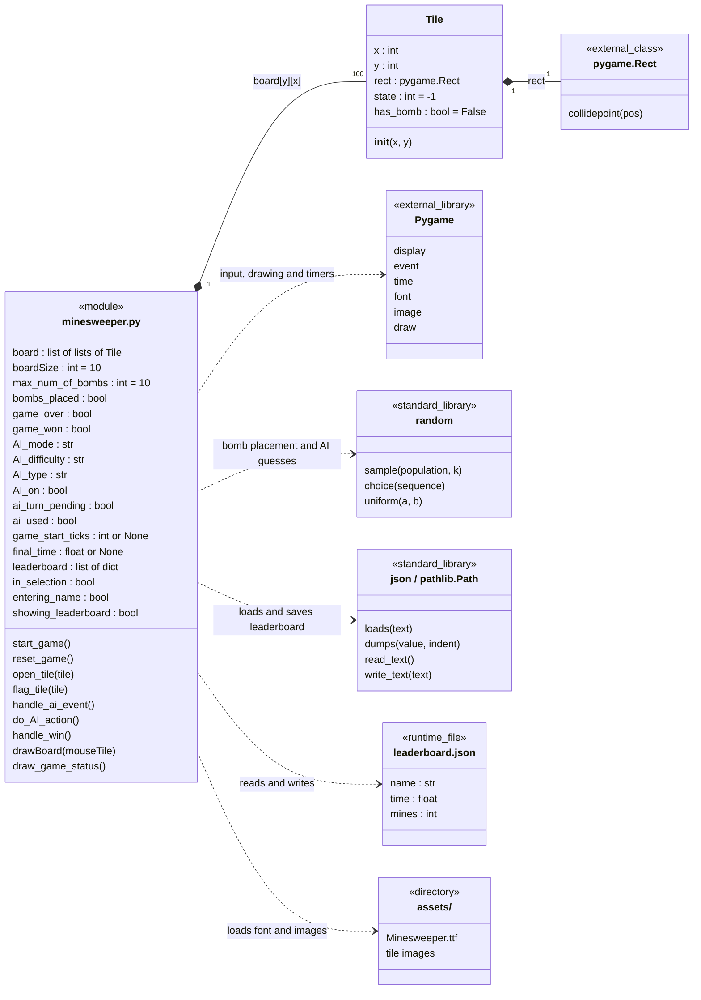
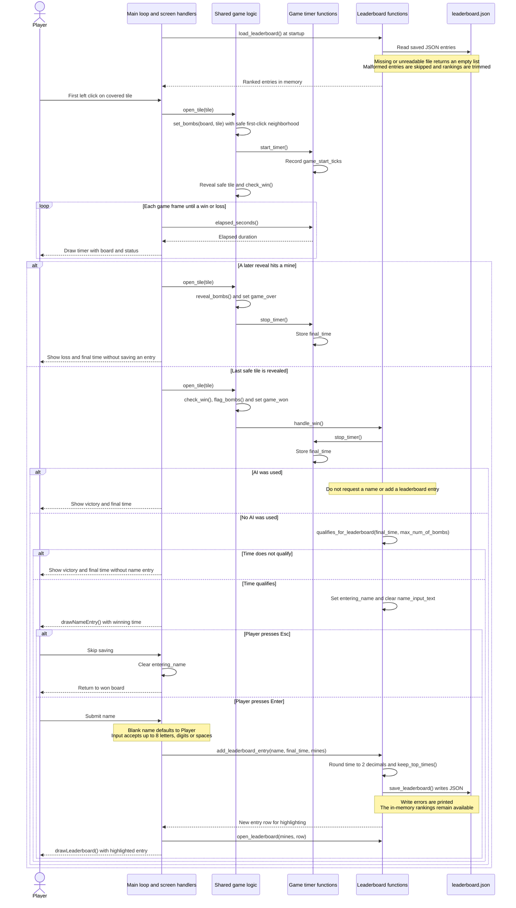
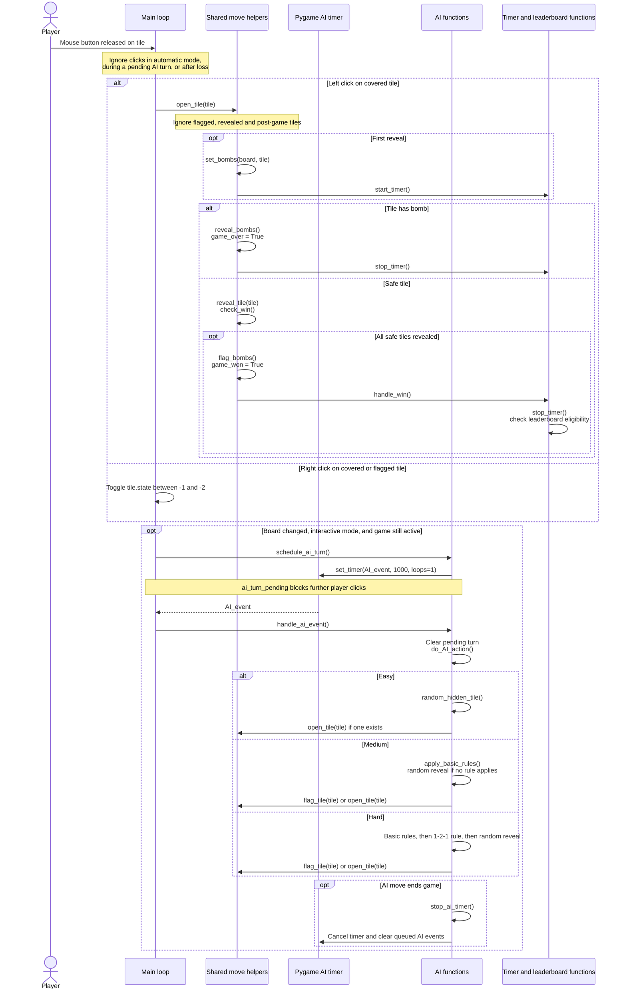

<!--
# Course: EECS 581: Software Engineering II
# Project: Minesweeper
# Description: System architecture and UML diagrams of the module, tile class,
#              game states, AI turns and custom timer/leaderboard feature.
#              Based on main at commit c9504510565278e184dbc941f866d0328342ab66.
# Inputs:
#     Current minesweeper.py source, module state and event handling.
# Outputs:
#     Architecture overview and UML structure, state and sequence diagrams.
# Author: Carter Steenhard
# Source attribution: Original project documentation created with the assistance
#                     of OpenAI Codex, describing the existing source implementation.
# Date: 10/11/2026
-->

# NewUML

Source: [`EECS-581-Project-1-Group-2/minesweeper.py`](../EECS-581-Project-1-Group-2/minesweeper.py).
These Mermaid diagrams render directly on GitHub.

<!--
# ---------------------------------------------------------------------------
# System architecture overview
#
# Boxes group responsibilities inside the existing minesweeper.py module.
# Arrows show input, shared state, rendering and persisted leaderboard data.
# These are logical components, not additional Python classes or files.
# ---------------------------------------------------------------------------
-->

## System architecture overview

The main loop routes input to the active screen and redraws it at up to 60 frames
per second. Player and AI reveals use the same move helpers and the same
`board[y][x]` tile objects. Interactive AI replies use a one-shot Pygame timer;
automatic AI uses a repeating timer. The game-duration timer separately measures
elapsed Pygame ticks. Restart replaces the board and clears game/timer state,
while saved leaderboard entries remain available.

For future extensions, add AI strategies through `do_AI_action()` and the shared
move helpers, add display information through the drawing functions, and preserve
the leaderboard entry fields when changing persistence. The existing function
groups below identify where each responsibility is implemented.

<!--
# ---------------------------------------------------------------------------
# Module and tile structure
#
# Tile is the only application class. The other boxes describe the existing
# module, external libraries and files; they do not represent new game classes.
# Module members shown here are the main state variables and entry points.
# ---------------------------------------------------------------------------
-->

## Module and tile structure

`board` contains 10 rows of 10 tiles. `reset_game()` replaces all tiles.
Tile states are `-1` covered, `-2` flagged, `-3` revealed bomb, `0` blank,
and `1` through `8` the number of neighboring bombs. First-click placement
excludes the clicked tile and all its neighbors. The selected mine count is 10–20.
`leaderboard.json` is created at runtime beside `minesweeper.py`; each entry is a
dictionary, and each mine count retains its fastest 10 times.

### Module function groups

All functions below are defined directly in `minesweeper.py`. These groups follow
the source's sections and explain the responsibilities behind the diagram.

| Responsibility | Existing functions |
| --- | --- |
| Board creation, lookup and reveal | `set_bombs`, `getTile`, `reveal_tile`, `reveal_bombs`, `check_win`, `flag_bombs`, `reset_game`, `set_tile_state`, `is_valid_index` |
| Shared player and AI moves | `neighbors`, `hidden_tiles`, `random_hidden_tile`, `open_tile`, `flag_tile` |
| Game timer | `start_timer`, `stop_timer`, `elapsed_seconds` |
| AI selection and timing | `set_bot_type`, `start_ai_timer`, `stop_ai_timer`, `schedule_ai_turn`, `handle_ai_event`, `do_AI_action` |
| AI strategies | `easy_AI_action`, `apply_basic_rules`, `medium_AI_action`, `apply_121_rule`, `hard_AI_action` |
| Selection screen | `parse_mine_count`, `draw_button`, `draw_option_row`, `drawSelection`, `handle_selection_event`, `start_game` |
| Board and text rendering | `drawBoard`, `draw_game_status`, `draw_text_centered`, `draw_text_aligned` |
| Leaderboard and name entry | `keep_top_times`, `times_for_mines`, `load_leaderboard`, `save_leaderboard`, `qualifies_for_leaderboard`, `add_leaderboard_entry`, `handle_win`, `open_leaderboard`, `drawNameEntry`, `handle_name_entry_event`, `drawLeaderboard`, `handle_leaderboard_event` |
| Controls help box | `open_info`, `close_info`, `info_lines`, `drawInfo`, `handle_info_event` |
| Legacy bomb helpers | `can_place_bomb`, `get_rand_chance` (not used by the current `set_bombs` placement path) |

<!--
# ---------------------------------------------------------------------------
# Custom addition: game timer and local leaderboard
#
# This UML sequence describes the implemented custom feature: measuring game
# duration and saving the fastest eligible manual wins for each mine count.
# It includes losses, AI-assisted wins, nonqualifying times and skipped names.
# ---------------------------------------------------------------------------
-->

## Custom addition: game timer and local leaderboard

The custom feature measures game duration and stores the fastest manual wins.
Timing starts on the first reveal, ends on a win or loss, and displays a fixed
final time after the game ends. A qualifying manual win prompts for a name and
saves a ranked entry for that game's mine count.

Each entry contains `name` (string), `time` (seconds), and `mines` (integer).
`keep_top_times()` retains at most 10 entries for each mine count, with lower
times first and earlier entries ahead when times tie. A full ranking requires
a strictly faster time to qualify. Games started in an AI mode or assisted
through `E` are excluded. The `L` key and menu leaderboard button let the player
view existing results without adding a score; Left/Right selects the mine count.

The timer continues measuring elapsed ticks while a leaderboard overlay is open
during an unfinished game. Closing that overlay resumes the existing board.
Restart resets timing but keeps the stored leaderboard.

<!--
# ---------------------------------------------------------------------------
# Game and screen states
#
# States summarize the main loop's flags. Leaderboard and name entry are
# overlays; closing the leaderboard returns to the screen underneath it.
# ---------------------------------------------------------------------------
-->

## Game and screen states

```mermaid
stateDiagram-v2
    [*] --> Selection : initialize Pygame, assets, board and leaderboard
    Selection --> Game : start_game() / valid mine count and selected AI settings

    state Game {
        [*] --> Ready
        Ready --> Playing : first open_tile() / set_bombs(), start_timer()
        Playing --> Lost : open_tile() hits bomb / reveal_bombs(), stop_timer()
        Playing --> Won : check_win() / flag_bombs(), handle_win()
        Ready --> Ready : R / reset_game()
        Playing --> Ready : R / reset_game()
        Lost --> Ready : R / reset_game()
        Won --> Ready : R / reset_game()
    }

    Won --> Selection : M / return_to_menu()
    Lost --> Selection : M / return_to_menu()
    Game --> Info : ? button, I or ? key / open_info()
    Info --> Game : any key or click / close_info(); same board
    Won --> NameEntry : no AI used and time qualifies
    NameEntry --> Leaderboard : Enter / add_leaderboard_entry(), open_leaderboard()
    NameEntry --> Won : Esc / skip saving
    Selection --> Leaderboard : leaderboard button
    Game --> Leaderboard : L / open_leaderboard()
    Leaderboard --> Leaderboard : Left or Right / change mine count
    Leaderboard --> ReturnScreen : other key or mouse click / close overlay
    state ReturnScreen <<choice>>
    ReturnScreen --> Selection : in_selection
    ReturnScreen --> Game : game screen underneath; keep existing board and flags
```

The main loop processes name entry or leaderboard events before selection and game
events. Those overlays suspend game-event processing. A win without a qualifying
manual time stays on the won board. Closing an overlay keeps the underlying game
state; it does not reset the board. Window-close events call `pygame.quit()` and
`sys.exit()` from any screen.

The game draws elapsed time, remaining mines (`max_num_of_bombs` minus flags),
and status every frame. Remaining mines can be negative when too many flags are
placed. Status distinguishes victory, loss, manual play, interactive AI,
automatic AI and paused automatic AI.

<!--
# ---------------------------------------------------------------------------
# Interactive AI turn
#
# Player reveals and AI reveals use open_tile(). A player flag change also
# schedules an interactive reply. Automatic mode uses a repeating timer.
# ---------------------------------------------------------------------------
-->

## Interactive AI turn

One AI turn can flag or reveal several tiles when a deduction applies. All AI
reveals use the same bomb placement, flood fill, timer, win and loss handling
as player reveals. Basic rules flag known mines or reveal neighbors once all
adjacent mines are flagged. Hard mode also checks horizontal and vertical 1-2-1
patterns whose covered neighbors lie on a single side.

Automatic mode starts a repeating 1000 ms timer in `reset_game()`. The `E` key
toggles repeating AI play and selects easy difficulty if none was selected.
Restarting cancels queued AI events and restarts the timer only for automatic
mode. Games started in either AI mode, or assisted through `E`, are excluded
from the leaderboard.
