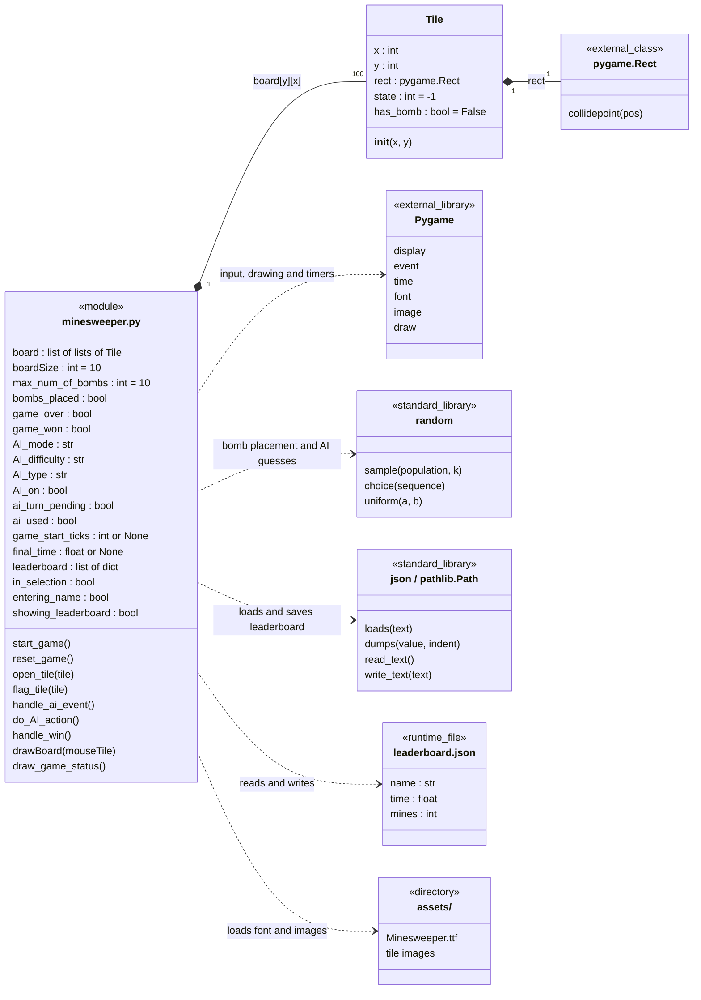
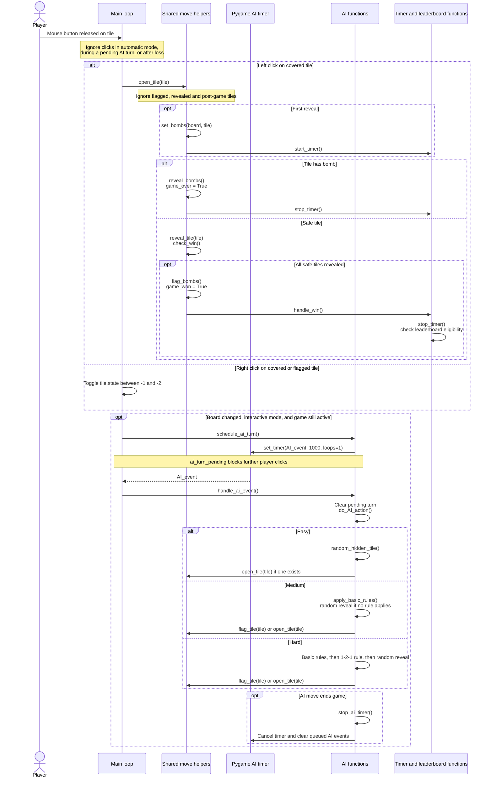

<!--
# Course: EECS 581: Software Engineering II
# Project: Minesweeper
# Description: UML diagrams of the current module, tile class, game states and AI turns.
#              Based on main at commit 9b3d37a426c3ebd7c3cc82afbf9968925be48524.
# Inputs:
#     Current minesweeper.py source, module state and event handling.
# Outputs:
#     UML structure, state and sequence diagrams rendered with Mermaid.
# Created with the assistance of OpenAI Codex.
# Date: 10/11/2026
-->

# NewUML

Source: [`EECS-581-Project-1-Group-2/minesweeper.py`](../EECS-581-Project-1-Group-2/minesweeper.py).
These Mermaid diagrams render directly on GitHub.

<!--
# ---------------------------------------------------------------------------
# Module and tile structure
#
# Tile is the only application class. The other boxes describe the existing
# module, external libraries and files; they do not represent new game classes.
# Module members shown here are the main state variables and entry points.
# ---------------------------------------------------------------------------
-->

## Module and tile structure

`board` contains 10 rows of 10 tiles. `reset_game()` replaces all tiles.
Tile states are `-1` covered, `-2` flagged, `-3` revealed bomb, `0` blank,
and `1` through `8` the number of neighboring bombs. First-click placement
excludes the clicked tile and all its neighbors. The selected mine count is 10–20.
`leaderboard.json` is created at runtime beside `minesweeper.py`; each entry is a
dictionary, and each mine count retains its fastest 10 times.

### Module function groups

All functions below are defined directly in `minesweeper.py`. These groups follow
the source's sections and explain the responsibilities behind the diagram.

| Responsibility | Existing functions |
| --- | --- |
| Board creation, lookup and reveal | `set_bombs`, `getTile`, `reveal_tile`, `reveal_bombs`, `check_win`, `flag_bombs`, `reset_game`, `set_tile_state`, `is_valid_index` |
| Shared player and AI moves | `neighbors`, `hidden_tiles`, `random_hidden_tile`, `open_tile`, `flag_tile` |
| Game timer | `start_timer`, `stop_timer`, `elapsed_seconds` |
| AI selection and timing | `set_bot_type`, `start_ai_timer`, `stop_ai_timer`, `schedule_ai_turn`, `handle_ai_event`, `do_AI_action` |
| AI strategies | `easy_AI_action`, `apply_basic_rules`, `medium_AI_action`, `apply_121_rule`, `hard_AI_action` |
| Selection screen | `parse_mine_count`, `draw_button`, `draw_option_row`, `drawSelection`, `handle_selection_event`, `start_game` |
| Board and text rendering | `drawBoard`, `draw_game_status`, `draw_text_centered`, `draw_text_aligned` |
| Leaderboard and name entry | `keep_top_times`, `times_for_mines`, `load_leaderboard`, `save_leaderboard`, `qualifies_for_leaderboard`, `add_leaderboard_entry`, `handle_win`, `open_leaderboard`, `drawNameEntry`, `handle_name_entry_event`, `drawLeaderboard`, `handle_leaderboard_event` |
| Legacy bomb helpers | `can_place_bomb`, `get_rand_chance` (not used by the current `set_bombs` placement path) |

<!--
# ---------------------------------------------------------------------------
# Game and screen states
#
# States summarize the main loop's flags. Leaderboard and name entry are
# overlays; closing the leaderboard returns to the screen underneath it.
# ---------------------------------------------------------------------------
-->

## Game and screen states

```mermaid
stateDiagram-v2
    [*] --> Selection : initialize Pygame, assets, board and leaderboard
    Selection --> Game : start_game() / valid mine count and selected AI settings

    state Game {
        [*] --> Ready
        Ready --> Playing : first open_tile() / set_bombs(), start_timer()
        Playing --> Lost : open_tile() hits bomb / reveal_bombs(), stop_timer()
        Playing --> Won : check_win() / flag_bombs(), handle_win()
        Ready --> Ready : R / reset_game()
        Playing --> Ready : R / reset_game()
        Lost --> Ready : R / reset_game()
        Won --> Ready : R / reset_game()
    }

    Won --> NameEntry : no AI used and time qualifies
    NameEntry --> Leaderboard : Enter / add_leaderboard_entry(), open_leaderboard()
    NameEntry --> Won : Esc / skip saving
    Selection --> Leaderboard : leaderboard button
    Game --> Leaderboard : L / open_leaderboard()
    Leaderboard --> Leaderboard : Left or Right / change mine count
    Leaderboard --> ReturnScreen : other key or mouse click / close overlay
    state ReturnScreen <<choice>>
    ReturnScreen --> Selection : in_selection
    ReturnScreen --> Game : game screen underneath; keep existing board and flags
```

The main loop processes name entry or leaderboard events before selection and game
events. Those overlays suspend game-event processing. A win without a qualifying
manual time stays on the won board. Closing an overlay keeps the underlying game
state; it does not reset the board. Window-close events call `pygame.quit()` and
`sys.exit()` from any screen.

The game draws elapsed time, remaining mines (`max_num_of_bombs` minus flags),
and status every frame. Remaining mines can be negative when too many flags are
placed. Status distinguishes victory, loss, manual play, interactive AI,
automatic AI and paused automatic AI.

<!--
# ---------------------------------------------------------------------------
# Interactive AI turn
#
# Player reveals and AI reveals use open_tile(). A player flag change also
# schedules an interactive reply. Automatic mode uses a repeating timer.
# ---------------------------------------------------------------------------
-->

## Interactive AI turn

One AI turn can flag or reveal several tiles when a deduction applies. All AI
reveals use the same bomb placement, flood fill, timer, win and loss handling
as player reveals. Basic rules flag known mines or reveal neighbors once all
adjacent mines are flagged. Hard mode also checks horizontal and vertical 1-2-1
patterns whose covered neighbors lie on a single side.

Automatic mode starts a repeating 1000 ms timer in `reset_game()`. The `E` key
toggles repeating AI play and selects easy difficulty if none was selected.
Restarting cancels queued AI events and restarts the timer only for automatic
mode. Games started in either AI mode, or assisted through `E`, are excluded
from the leaderboard.
